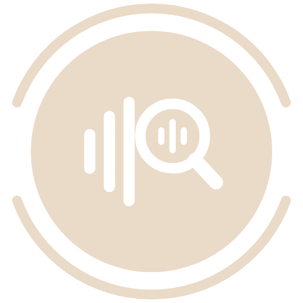
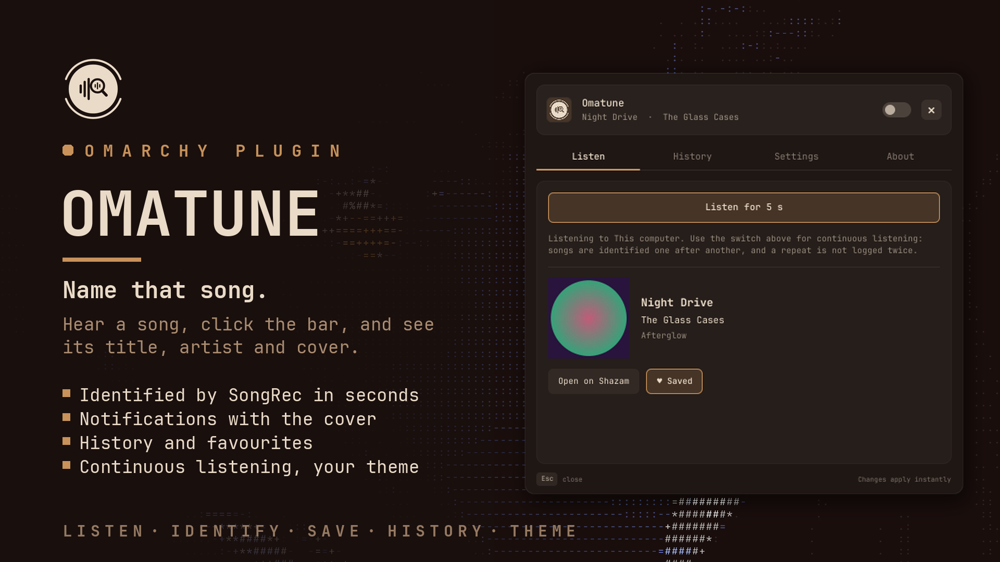
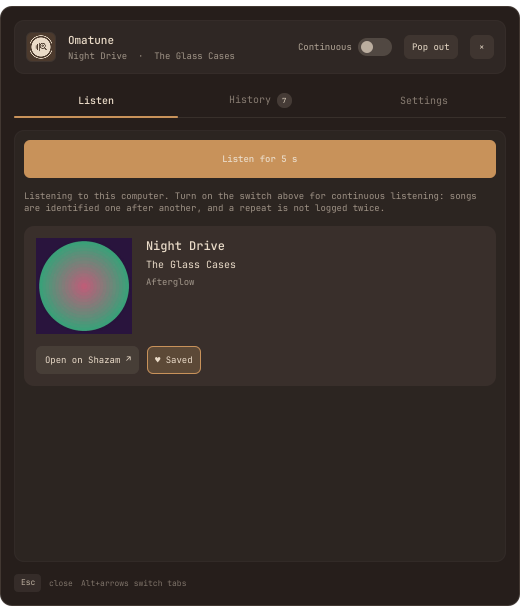
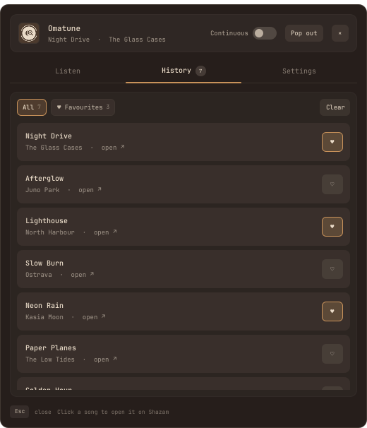
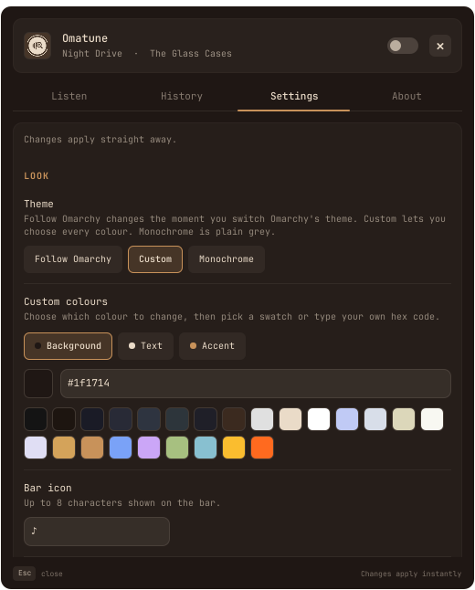
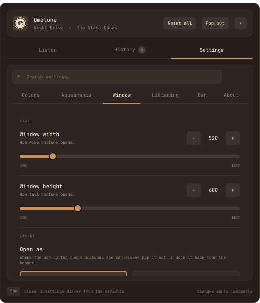
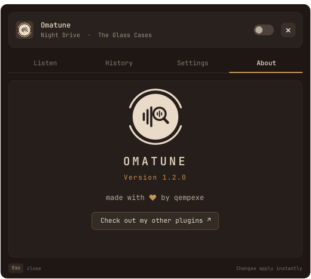

<p align="center">
  <picture>
    <source media="(prefers-color-scheme: light)" srcset="assets/logo-dark.png">
    
  </picture>
</p>

<h1 align="center">Omatune</h1>

<p align="center">Song recognition in your <a href="https://omarchy.org">Omarchy</a> bar: click, let it listen for a few seconds, and see the song.</p>



Click the icon, let it listen for a few seconds, and the song appears as a notification
with its cover, title and artist, on the bar, and in your history. It listens to what
this computer plays or to the room, and it can keep going, one song after another.
It opens docked to the bar, or pops out into a window of its own.

## Features

- **Identify** a song from a few seconds of sound, with [SongRec](https://github.com/marin-m/SongRec).
- **This computer or the microphone**: what is playing here, or what is playing in the room.
- **Continuous listening**: one song after another, with no clicks, and a repeat logged only once.
- **Notifications** with the title, the artist, the album and the cover.
- **History and favourites**: the latest songs, and the ones you save, kept apart.
- **Your theme**: follows your Omarchy theme live, takes your window border's colors, or
  uses your own colors exactly, or none at all.
- **Docked or popped out**: a panel on the bar, or a window you can move, resize and tile.
- **Made to fit**: card style, spacing, roundness, text size, window size, outline,
  tint and opacity, all in a searchable Settings tab.

### Listen



Press **Listen** to record a few seconds (4 to 20, as you set it), or flip the switch in
the header for **continuous listening**: songs are identified one after another until
you switch it off, and the same song heard twice is not logged or notified twice.

The last song found shows with its cover, title, artist and album, with **Open on
Shazam** and **♡ Save**. The bar shows it next to the icon, if you like.

<br clear="right">

### History and favourites



The latest songs, newest first. Click one to open it on Shazam, and **♡** to save it.
**♥ Favourites** shows only the saved ones. They are kept apart from the history, so
clearing the history keeps them, and they don't count toward how many songs the
history keeps.

<br clear="right">

## Installation

```bash
omarchy plugin add https://github.com/qempexe/omarchy-omatune.git --enable --yes
omarchy restart shell
```

Then add **Omatune** to your bar, from the bar settings or with
`{ "id": "io.github.qempexe.omatune" }` under `bar` → `layout` in
`~/.config/omarchy/shell.json`.

It needs:

- [SongRec](https://github.com/marin-m/SongRec), with its `songrec` command on your
  `PATH`. Install the `songrec` package yourself; Omatune never installs anything.
  While it's missing, the Listen tab says so, with a **Recheck** button for once it's there.
- PipeWire (`pw-record`) or PulseAudio (`parecord`) to record.
- `curl` and `vipsthumbnail` (libvips) for the covers, `notify-send` for the
  notifications and `xdg-open` for links. Omarchy has them all.

## Usage

### Bar button

| Click | Opens |
| --- | --- |
| Left | opens Omatune on the Listen tab, or closes it |
| Middle | the History tab (or *Listen now*, or nothing: see **Middle click**) |
| Right | the Settings tab |

**Esc** or **×** closes it, and **Alt+←/→** switches tabs.

### Pop out and dock

The header's **Pop out** turns Omatune into a real window you can move, resize and
tile, and **Dock** puts it back on the bar. The open tab, the search and the history
filter survive the switch. **Settings › Window › Open as** picks which one the bar
button opens.

Hyprland tiles new windows. To float and center the popped-out window, add to
`~/.config/hypr/hyprland.lua`:

```lua
o.window({ class = "^org\\.quickshell$", title = "^Omatune$" }, { tag = "+omatune-window" })
o.window({ tag = "omatune-window" }, { float = true })
o.window({ tag = "omatune-window" }, { center = true })
o.window({ tag = "omatune-window" }, { size = { 520, 600 } })
```

### What happens when you listen

1. `pw-record` (or `parecord`) records a short clip to `~/.cache/omatune/`. *This
   computer* records the monitor of the default output, *Microphone* the default input.
2. `songrec audio-file-to-recognized-song` reads it and prints the answer. The clip is
   deleted straight after.
3. The title, artist, album, cover and link are read from the answer, and the song goes
   into the history and the notification.

## Configuration

The **Settings** tab, or a right click on the bar button. Everything applies at once and
is saved in `~/.local/state/omarchy-omatune/settings.json`.

<table>
<tr>
<td></td>
<td></td>
<td></td>
</tr>
</table>

The settings sit in tabs, with a search box above them that looks through every tab.
Each row has a **↺** to put it back, and **Reset all** in the header puts back everything.

| Tab | Setting | Default | |
| --- | --- | --- | --- |
| Colors | Colors | Follow theme | Follow theme, Window borders, Custom or Monochrome |
| | Custom colors | | background, text and accent, a swatch or a hex code, used exactly as you pick them |
| | Text | Always readable | or Theme, or My text color |
| Appearance | Card style | Soft | Soft, Outline or Flat |
| | Spacing | Comfortable | Compact, Comfortable or Spacious |
| | Roundness | 4 | 0 (square) to 20 |
| | Text size | 1 | 0.8 to 1.5 |
| | Show the cover | on | the last song's cover in the Listen tab |
| Window | Window width, height | 520 × 600 | 400 to 1200, 420 to 1100 |
| | Open as | Bar panel | or Own window |
| | Window outline | off | the edge in your window border's colors, as a gradient or one color |
| | Window tint | 0 | 0 to 30, the accent washed over the background |
| | Window opacity | 97 | 50 to 100 |
| Listening | Listen to | This computer | or Microphone |
| | Listen length | 5 s | 4 to 20 seconds |
| | Notify when a song is found | on | with the cover, for 8 s (2 to 30) |
| | Songs to keep | 20 | 5 to 100 |
| Bar | Bar button shows | Both | Icon, Last song or Both |
| | Bar icon | ♪ | up to 8 characters |
| | Middle click | History | or Listen now, or Nothing |

**Window borders** and the outline read the active border from your theme's
`hyprland.lua` (or `hyprland.conf`), and only take `#rrggbb` colors and an angle from it.
Settings saved by Omatune 1.1 keep working.

**About**, the last tab, has the logo, the version and a link to more plugins.

## Troubleshooting

- **Nothing found.** Identifying needs a clear part of a song. A quiet or noisy clip, or
  a short one, often finds nothing; try a longer listen.
- **It stopped finding songs.** SongRec talks to an unofficial Shazam interface. Update
  SongRec. If songs are found but details are missing, check what
  `songrec audio-file-to-recognized-song <file.wav>` prints and open an issue.
- **Privacy.** Identifying sends a fingerprint of the clip to Shazam, through SongRec.
  The clip is recorded into `~/.cache/omatune/capture`, a folder only you can open
  (0700), as a file only you can read (0600), and deleted as soon as SongRec has read
  it. Omatune won't record if that folder is a link or isn't yours. The only other
  network use is downloading the cover from the https address Shazam gives.
- **Covers.** A cover is never shown as it is downloaded: `curl` fetches it over https
  only, with a size cap (8 MiB) and a time limit, and `vipsthumbnail` makes it into a
  small, clean PNG in a separate process with a memory and a time limit. Only that PNG
  is shown, in the panel and in the notification. The copies live in
  `~/.cache/omatune/covers` and are cleared at every start.
- **Files.** The history is in `~/.local/state/omatune/history.json` and the favourites
  in `favourites.json` next to it. Both are checked when they are read back. That
  folder and the settings folder are made private (0700) at every start.
- **Text fields.** The search, bar icon and hex fields never read the clipboard by themselves.
  **Ctrl+V** (or **Shift+Insert**) pastes once through `wl-paste`, the first line only,
  at most 1 KB.

## Contributing

Bug reports and ideas are welcome as [issues](https://github.com/qempexe/omarchy-omatune/issues).
[CONTRIBUTING.md](CONTRIBUTING.md) explains how to add a setting, the rules and the
tests. Everyone taking part is expected to follow the [code of conduct](CODE_OF_CONDUCT.md).
What changed in each version is in the [changelog](CHANGELOG.md).

### Source layout

```
qml/
├── BarWidget.qml     the bar button, recording and identifying, notifications, history,
│                     docking and popping out, the theme's border, the capped paste
├── core/             UiState (colors, spacing, the open tab), SettingsStore (saved
│                     locally, applied at once), ArtCache (covers, made safe), Run
├── panel/            Panel (docked), PopoutWindow, TuneView (the window), ListenPage,
│                     HistoryPage, SettingsView + SettingRow + TileArt, AboutPage
├── controls/         Btn, Chip, Sw, Txt, PasteInput (a text field with a bounded paste)
└── js/               Schema.js (every setting), Model.js (pure logic), Theme.js
                      (border colors), Art.js (cover limits)
assets/               the logo, light and dark
tools/gen-manifest.js node tools/gen-manifest.js
tests/test_model.js   node tests/test_model.js
```

### Upgrading and uninstalling

```bash
omarchy plugin update io.github.qempexe.omatune
omarchy restart shell
```

```bash
omarchy plugin remove io.github.qempexe.omatune
omarchy restart shell
rm -rf ~/.local/state/omatune ~/.local/state/omarchy-omatune ~/.cache/omatune   # history, favourites, settings, covers
```

## License and credits

[MIT](LICENSE).

- Built around **SongRec** by Marin M. ([github.com/marin-m/SongRec](https://github.com/marin-m/SongRec)), which does the recognition. Omatune is a bar front end for it.
- Thanks to the **Omarchy** project for the shell and its plugin system, and to **Quickshell** and **Qt** for the toolkit.
- Thanks to everyone who tests it and reports issues.

Omatune is an independent community plugin. It is not affiliated with or endorsed by
SongRec, Shazam, Apple or Omarchy. Shazam is a trademark of its owner; the name is used
only to describe what the plugin connects to.
